# PWA-hydro-conditioning-tools — Codebase Overview

> Reference document for coding agents and new contributors. Describes the
> current architecture of `pwa_tools` as of the 2026 refactor (the
> "god-file" split referenced throughout the source docstrings). Written
> while scoping a new **wetland catchment geometry delineation** feature —
> update this file when that feature lands, and whenever module
> responsibilities shift materially.

## 1. What this package does

`pwa_tools` implements **Step 0** of the Prairie Watershed Analytics (PWA)
modelling pipeline: "hydro-conditioning" — preparing a LiDAR DEM + hydrology
layers for a watershed so that downstream Raven hydrologic modelling
(`pwa_raven`, a sibling package) has a depression-corrected DEM, per-subbasin
depression statistics, and (optionally) wetland polygons / wetland catchment
estimates.

It is a sub-module of the `PWA-modeling` repository (`PWA-hydro-conditioning-tools`
is its own repo, consumed as a dependency). It replaces a legacy 1,175-line
`__init__.py` "god file" that used a global, picklable `state` singleton; that
object has been fully replaced by an explicit, frozen `PwaConfig` passed
through every function call — **there is no hidden global state in the
current codebase**, despite `CONTRIBUTING.md` still describing the old
`state`/`.pkl` workflow (that doc is stale; don't follow it for new code).

## 2. Module map

```
pwa_tools/
├── __init__.py        Package docstring + __version__ only. No logic.
├── config.py           PwaPaths / PwaInputs / PwaConfig — all pipeline config.
├── ui.py                Interactive input() prompts → builds a PwaConfig.
├── init_config.py       CLI: `python -m pwa_tools.init_config out.yml` (writes YAML from prompts).
├── runner.py             run_step0(config) — orchestrates the full pipeline. The one place
│                         that calls every domain module in sequence.
├── run_step0.py          CLI: `python -m pwa_tools.run_step0 --config pwa_config.yml [--wetlands]`.
├── _wbt.py               WhiteboxTools wrapper: wbt_session() context manager + check_wbt().
│                         Every WBT call in the codebase goes through this.
├── depression.py         gen_depressions_raster(), calc_depression_depths().
├── streams.py            extend_line(), append_culvert_lines(), clip_nhn_to_watershed().
├── projection.py         project_subbasins_to_nhn(), project_subbasins_to_lidar().
├── wetlands.py           gen_direction_raster(), gen_accum_raster(), gen_wetland_polygons().
│                         ← wetland catchment geometry feature will live here.
├── io/
│   ├── raster.py         resample_lidar_raster(), clip_lidar_to_shapefile(), merge_rasters(),
│   │                     reproject_raster(), crs_uses_metres().
│   └── shapefile.py      read_shapefile() — single CRS-aware shapefile reader used everywhere.
└── WBT/                  Bundled WhiteboxTools binary + Python wrapper (Windows only; gitignored
                           on other platforms — falls back to the `whitebox` pip package).
```

Each domain module's docstring states exactly which lines of the old god file
it replaces and what bugs were fixed in the extraction (unchecked WBT return
codes, `os.chdir` without `try/finally`, global `state` reads/writes, string
path concatenation). That provenance is useful context before touching any
of these files.

## 3. Configuration model

```
PwaConfig (frozen dataclass)
├── watershed_name: str
├── paths: PwaPaths            # derived, not stored — base_data/watershed_name → full dir tree
├── inputs: PwaInputs           # user-supplied filenames + target CRS
├── output_res_m / processing_res_m
├── depth_llim / area_llim / volume_llim      # wetland-polygon filter thresholds
├── dem_source_dir: Path | None                # optional external LiDAR source
├── summarize_by_subbasin: bool                # gates step 12 (depression depths)
└── wetland_catchments: bool                   # gates D8 pointer + flow-accum raster generation
```

- `PwaConfig.from_yaml(path)` / `.from_dict(data)` / `.to_yaml(path)` / `.to_dict()`
  round-trip a `pwa_config.yml`. **Known gap:** `wetland_catchments` is present
  in `from_dict` but missing from `to_dict()` — a pre-existing inconsistency,
  not yet fixed.
- `PwaPaths.from_watershed(base_data, watershed_name)` derives (no I/O):
  `base_data/watershed_name/HydroConditioning/{Raw,Interim,Processed}`.
  `make_dirs()` creates them; `clean_interim()` wipes `Interim/` only (refuses
  to run unless the target directory is literally named `Interim`).
- `config.stage_inputs()` searches the data hierarchy for expected input files
  (CLRH shapefile, LiDAR raster(s), NHN shapefile, optional culvert shapefile)
  and moves them into `Raw/` before the pipeline starts — fails fast with a
  helpful message if anything is missing.

## 4. Pipeline — `runner.run_step0(config, generate_wetlands=False)`

```mermaid
flowchart TD
    A["config.stage_inputs()\nmove raw files into Raw/"] --> B["paths.make_dirs() + clean_interim()"]
    B --> C["read_shapefile(CLRH)\nsubbasins"]
    C --> D{"multiple LiDAR\nrasters?"}
    D -- yes --> D1["merge_rasters()\n(clips too)"]
    D -- no --> D2["read single LiDAR tif"]
    D1 --> E
    D2 --> E{"CRS uses\nmetres?"}
    E -- no --> E1["reproject_raster()"]
    E -- yes --> F
    E1 --> F["project_subbasins_to_lidar()"]
    F --> G{"multi-raster?"}
    G -- no --> G1["clip_lidar_to_shapefile()"]
    G -- yes --> H
    G1 --> H["resample_lidar_raster()\n→ processing_res_m"]
    H --> I["read_shapefile(NHN)\n(no reprojection yet)"]
    I --> J["project_subbasins_to_nhn()"]
    J --> K["clip_nhn_to_watershed()\n+ optional append_culvert_lines()"]
    K --> L["gen_depressions_raster()\nfill_burn → raster_calculator → conditional_evaluation"]
    L --> M{"config.wetland_catchments?"}
    M -- yes --> M1["gen_direction_raster() [WBT d8_pointer]"]
    M1 --> M2["gen_accum_raster() [WBT d8_flow_accumulation]"]
    M -- no --> N
    M2 --> N{"generate_wetlands\nflag?"}
    N -- yes --> N1["gen_wetland_polygons()\n(uses accum raster for wet_cat_m2 if available)"]
    N -- no --> O
    N1 --> O{"config.summarize_by_subbasin?"}
    O -- yes --> O1["calc_depression_depths()\nzonal_statistics per subbasin"]
    O -- no --> P
    O1 --> P["resample depression raster\n→ output_res_m"]
    P --> Q["return Step0Result\n(depression_raster, depression_depths, wetlands)"]
```



Every numbered step in `runner.py`'s own comments (`# 1.` … `# 13.`) maps
1:1 onto this diagram; read the function alongside it for exact call
signatures.

## 5. WhiteboxTools integration pattern

All WBT calls follow the same shape — never call `WhiteboxTools()` directly:

```python
from pwa_tools._wbt import wbt_session, check_wbt

with wbt_session() as wbt:
    check_wbt(wbt.some_tool(arg=...), "some_tool")
```

- `wbt_session()` resolves the right `WhiteboxTools` class (bundled
  `pwa_tools/WBT/` binary on Windows if present, else the `whitebox` pip
  package), sets the working directory to the *caller's* cwd (not WBT's own
  install dir), and restores cwd in a `finally` block even on exceptions.
- `check_wbt(return_code, tool_name)` raises `WBTError` on any non-zero
  return code (`1` = error, `2` = user-cancelled). Every WBT call in the
  codebase is wrapped — unchecked return codes were a class of bug fixed
  during the god-file extraction.
- Relevant WBT tools already used: `d8_pointer`, `d8_flow_accumulation`,
  `fill_depressions`, `raster_calculator`, `conditional_evaluation`, `clip`,
  `vector_polygons_to_raster`, `zonal_statistics`.
- Relevant WBT tools **available but not yet used** (needed for the planned
  wetland-catchment-geometry feature): `watershed` (delineate contributing
  area for a set of pour points), `snap_pour_points` / `jenson_snap_pour_points`
  (snap a user-placed point onto the true flow path), `unnest_basins`,
  `basins`.

## 6. Test layout

```
tests/
├── conftest.py            fixtures_dir fixture only.
├── unit/                  Mocked WBT/subprocess everywhere. Runs in CI (`make test`).
│                          One test file per source module, same name.
├── integration/           Drives real module CLIs (`python -m pwa_tools.run_step0`) against
│                          real binaries. Local-only (`make integration`); most tests skip
│                          cleanly without `$PWA_STEP0_CONFIG` except the no-config error path.
└── regression/            End-to-end WhiteboxTools + gdalwarp run vs. a committed baseline
                           (`grassmere-baseline.json`). Needs real watershed data; `make regression`.
```

Pytest markers (`pyproject.toml`): `regression`, `integration`, `slow`. CI
(GitHub Actions) runs **unit only**.

`tests/unit/test_depression.py` defines `_make_fake_wbt()`, reused across
unit test files (e.g. `test_wetlands.py`) to stub WBT calls with a
`MagicMock` whose tool methods write a fake output raster and return `0`.
Follow this pattern for any new WBT-calling function.

## 7. In-flight feature (context for the next agent)

**Wetland catchment geometry delineation** — not yet implemented. Today,
`gen_wetland_polygons()` only estimates catchment *area* per wetland
(`wet_cat_m2`, via max flow-accumulation value) when `config.wetland_catchments
= True`. Computing actual catchment *geometry* for every wetland in a
watershed is too expensive to run by default across hundreds/thousands of
wetlands, so the planned design is:

1. A new `gen_wetland_catchment_polygons()` in `wetlands.py` that takes a
   **user-supplied points shapefile** (wetlands of interest, marked by the
   user after reviewing `gen_wetland_polygons()` output in their own GIS),
   snaps each point with WBT `snap_pour_points`, delineates contributing
   area with WBT `watershed`, and vectorizes the result into labelled
   polygons (label assigned by sampling the output raster at each snapped
   point, not by relying on WBT's internal point numbering).
2. Config wiring: an optional `wetland_points_filename` field on `PwaConfig`
   (parallel to `culvert_filename`), validated to require
   `wetland_catchments=True`, so it can run automatically inside
   `run_step0` when the points file is already available.
3. A standalone CLI module (mirroring `run_step0.py`/`init_config.py`) so the
   delineation can be re-run on its own after a user marks points, without
   rerunning the whole pipeline — reusing the D8/accumulation rasters already
   on disk in `Processed/` from a prior `wetland_catchments=True` run.

See the session history for the fuller design discussion before implementing.
